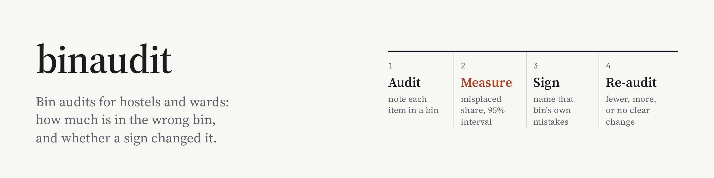
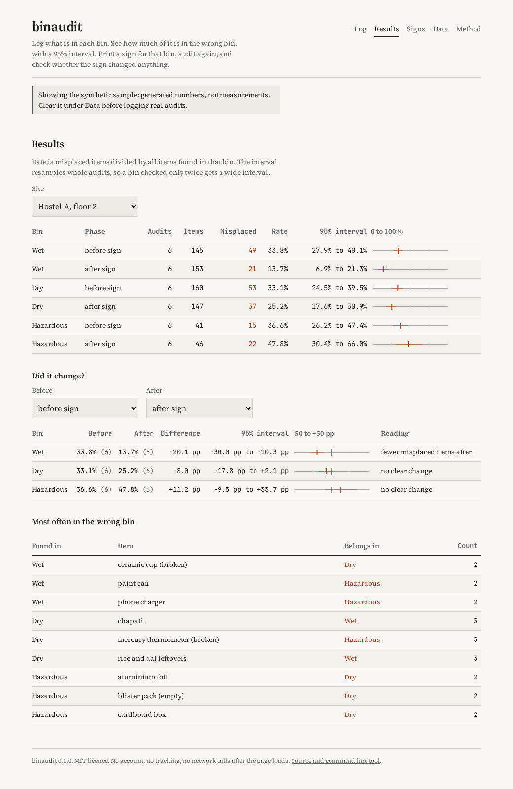
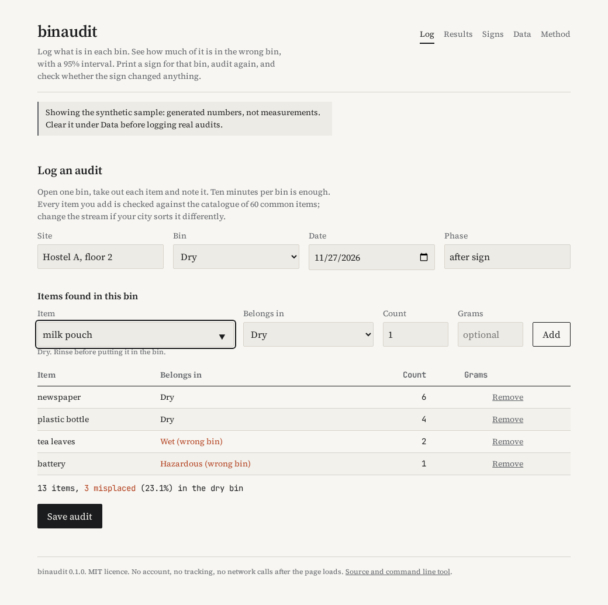
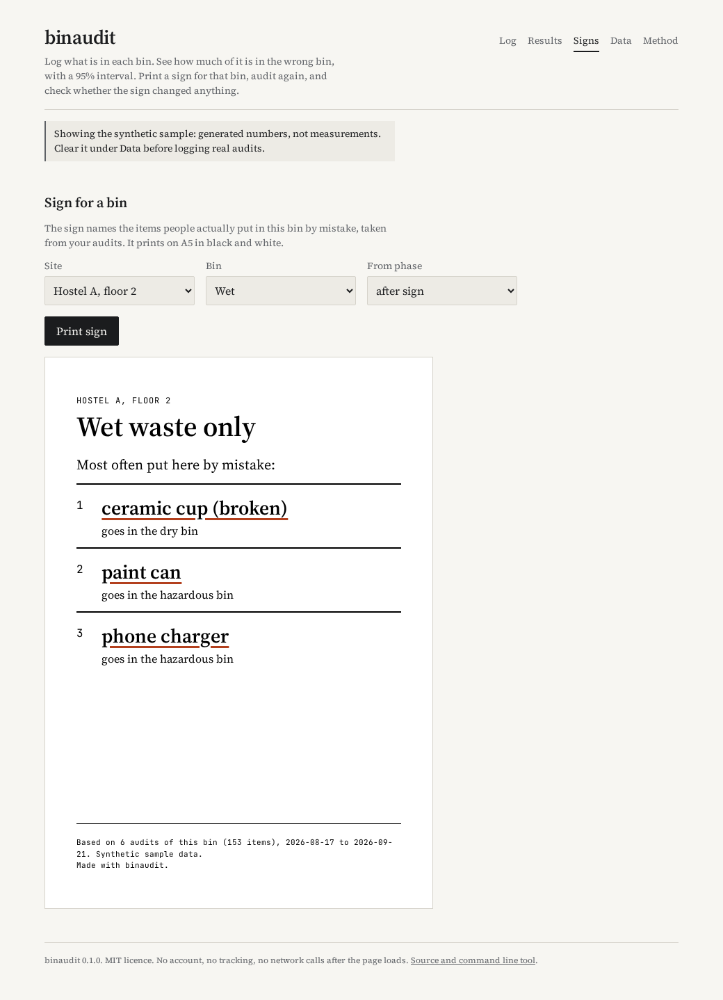

<p align="center">
  <picture>
    <source media="(prefers-color-scheme: dark)" srcset="docs/assets/banner-dark.png">
    
  </picture>
</p>

<p align="center">
  <a href="https://prafullj0shi.github.io/binaudit/"></a>
  <a href="tests"></a>
  
  
  <a href="LICENSE"></a>
</p>

**binaudit** is a small tool for a hostel floor, a college block or a ward that has put up
wet, dry and hazardous bins and wants to know whether people use them correctly. You open
a bin, note what is inside, and binaudit tells you how much of it is in the wrong bin, with
a 95% interval. It then prints a sign for that bin naming its own most common mistakes.
After a few more audits it tells you whether the sign changed anything, or that the data
cannot tell yet.

Open the app: **https://prafullj0shi.github.io/binaudit/**. It opens with a synthetic
sample so every screen has something to show; the sample is labelled as generated data and
is not a measurement.

## Why

Segregation at source is required under India's Solid Waste Management Rules, 2016, and
most campuses respond with posters. Posters are rarely checked. A bin audit, the standard
way waste researchers measure contamination, is easy to do but hard to read: ten items from
one bin are not ten independent observations, and a drop from 30% to 25% over two audits is
usually noise. binaudit does the arithmetic properly and says so in plain words.

## What it does

| Step | In the app | Detail |
|---|---|---|
| Audit | **Log** | Add items one by one; a 60-item catalogue suggests the right stream and flags wrong-bin items as you type. Works offline. |
| Measure | **Results** | Contamination rate per bin and phase, with a cluster bootstrap 95% interval and an interval bar. Small samples are flagged. |
| Act | **Signs** | An A5 sign, black and white, listing the three items most often put in that bin by mistake, with the audit dates it is based on. |
| Re-audit | **Results, Did it change?** | Before/after difference with an interval and a reading: fewer, more, or no clear change. |
| Keep | **Data** | CSV export and import. Data stays in the browser; nothing is sent anywhere. |

<p align="center">
  <picture>
    <source media="(prefers-color-scheme: dark)" srcset="docs/assets/results-dark.png">
    
  </picture>
</p>

| Log an audit | Printable sign |
|---|---|
|  |  |

## Facts about this version

- 60 items in the catalogue, each mapped to wet, dry or hazardous as in the SWM Rules, 2016.
- 27 tests (pytest), including parity between the browser and Python code.
- The browser and the Python tool give the same rates, intervals and comparisons on the
  sample, to within 1e-12; `tests/test_parity.py` checks this.
- The web app is plain HTML, CSS and JavaScript: about 40 KB of code plus 150 KB of
  self-hosted fonts, no build step, no third-party requests.
- The Python package has no runtime dependencies.

## Install the command line tool

Requires Python 3.10 or newer. Node.js is only needed to run the parity test.

Windows (PowerShell):

```powershell
git clone https://github.com/PrafullJ0shi/binaudit
cd binaudit
py -m venv .venv
.venv\Scripts\Activate.ps1
pip install -e ".[dev]"
binaudit summary web\data\sample-audits.csv
```

macOS and Linux:

```bash
git clone https://github.com/PrafullJ0shi/binaudit && cd binaudit
python3 -m venv .venv && . .venv/bin/activate
pip install -e ".[dev]"
binaudit summary web/data/sample-audits.csv
```

Then export a CSV from the app's **Data** page and run:

```bash
binaudit compare my-audits.csv --before "before sign" --after "after sign"
binaudit report my-audits.csv -o report.md
```

See [docs/CLI.md](docs/CLI.md) for every command.

## Run the web app locally

The app is static. Any local web server works:

```bash
python -m http.server 8000 --directory web
```

and open http://localhost:8000. Opening `index.html` directly from disk does not work,
because browsers block module scripts on `file://` pages.

## Tests

```bash
python -m pytest -q
```

## Publishing the app

GitHub Pages serves the `gh-pages` branch, which holds only the contents of `web/`.
After changing anything in `web/`, run `sh scripts/publish-pages.sh` (Git Bash on
Windows).

## How it works

```
web/js/stats.js        rates, bootstrap, comparison  (browser)
src/binaudit/stats.py  the same arithmetic           (Python)
web/js/app.js          the four screens, localStorage
web/data/items.json    item catalogue (copied into the Python package; a test keeps them equal)
```

The method, including why items are not treated as independent, is in
[docs/METHOD.md](docs/METHOD.md). The CSV columns are in
[docs/DATA_FORMAT.md](docs/DATA_FORMAT.md). Design rules are in [DESIGN.md](DESIGN.md).

## Limits

- The catalogue follows the national rules; your municipality may sort some items
  differently. Change the stream when you log the item.
- A before/after change can have other causes. Audit a similar bin without a sign over the
  same weeks; [docs/METHOD.md](docs/METHOD.md#did-it-change) explains why.
- No real audit data ships with the project yet. The sample is synthetic.

## Roadmap

Control-bin comparison, per-site catalogue overrides, QR codes on signs and signs in Indian
languages. See [docs/ROADMAP.md](docs/ROADMAP.md).

## Credits

Fonts: Source Serif 4 (Adobe) and JetBrains Mono, both under the SIL Open Font License.
See [CHANGELOG.md](CHANGELOG.md) for changes. MIT licence.
